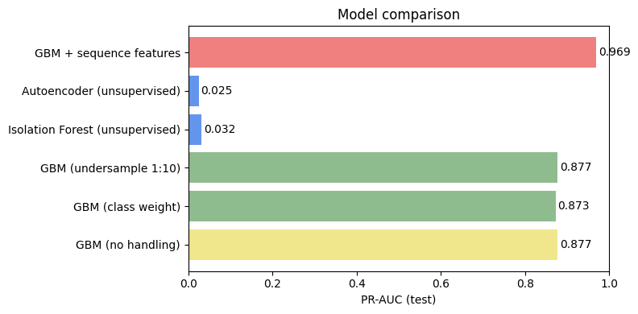
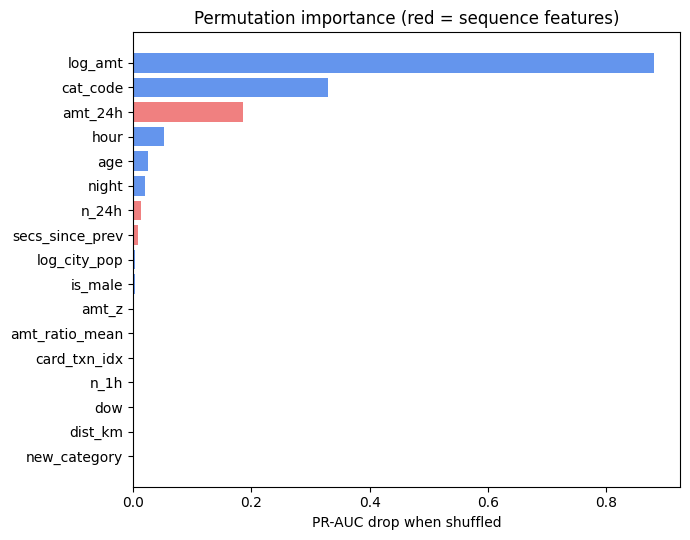
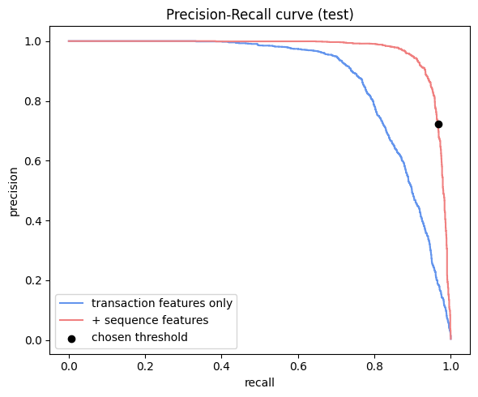
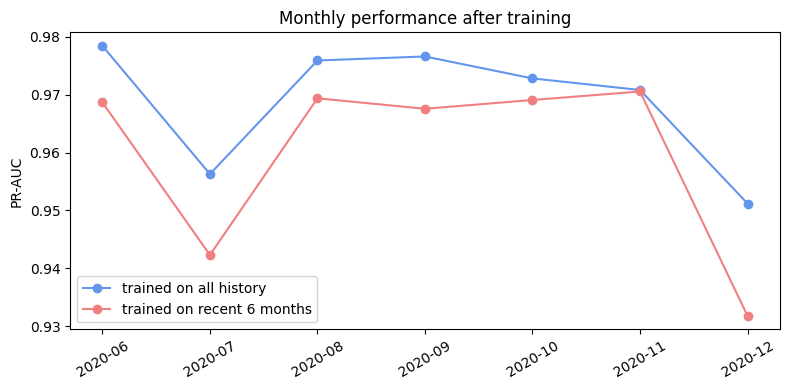

# 카드 거래 이상 탐지 (FDS)

카드 거래 약 185만 건으로 사기 거래 탐지 모델을 만들고, 불균형 처리, 비지도 탐지, 행동 시퀀스 피처, 시간에 따른 성능 변화를 비교했습니다.

- 데이터: [Kaggle kartik2112/fraud-detection](https://www.kaggle.com/datasets/kartik2112/fraud-detection) (Sparkov로 생성한 시뮬레이션 카드 거래, 2019.01~2020.12)
- 사기 비율: 학습 기간 0.58%, 테스트 기간 0.39%
- 분할: 학습 / 검증(학습 기간 마지막 2개월) / 테스트(이후 6개월)를 **시간 순서로** 나눔
- 지표: 불균형이 커서 정확도 대신 PR-AUC, Recall@P80(정밀도 80%일 때 재현율) 사용

## 결과

| 모델 | PR-AUC | ROC-AUC | Recall@P80 |
|---|---|---|---|
| GBM (처리 없음) | 0.877 | 0.997 | 0.815 |
| GBM (클래스 가중치) | 0.873 | 0.998 | 0.795 |
| GBM (언더샘플링 1:10) | 0.877 | 0.998 | 0.801 |
| Isolation Forest (비지도) | 0.032 | 0.860 | 0.000 |
| Autoencoder (비지도) | 0.025 | 0.804 | 0.000 |
| **GBM + 시퀀스 피처** | **0.969** | **0.999** | **0.958** |

### 1. 불균형 처리는 랭킹을 거의 바꾸지 않았다
가중치와 언더샘플링은 PR-AUC를 거의 바꾸지 않았습니다. 확률값의 크기는 달라지지만 사기를 위로 올리는 순서는 그대로라서, 임계값을 따로 정한다면 큰 차이가 없습니다.

### 2. 비지도 탐지는 ROC-AUC만 보면 괜찮아 보인다
정상 거래만 학습한 두 모델은 ROC-AUC가 0.8 이상이지만 PR-AUC는 0.03 수준입니다. 사기가 0.4%뿐인 데이터에서는 ROC-AUC가 성능을 부풀려 보여준다는 것을 확인했습니다.

### 3. 카드별 과거 행동이 가장 큰 차이를 만들었다
카드별로 **그 거래 이전 기록만** 사용해 직전 거래와의 간격, 최근 1시간·24시간 거래 수와 금액, 과거 평균 대비 금액 비율 등을 만들었습니다. PR-AUC가 0.877에서 0.969로 올랐고, 시퀀스 피처 중에서는 최근 24시간 사용 금액의 영향이 가장 컸습니다.

### 4. 검증 기간에 맞춘 기준은 테스트 기간에 그대로 유지되지 않았다
검증 데이터에서 정밀도 80%가 되도록 임계값을 정하고 테스트에 적용했습니다.

| 항목 | 값 |
|---|---|
| 잡은 사기 | 2,073건 / 2,145건 (재현율 96.6%) |
| 오탐 | 800건 (정상 거래의 약 0.14%) |
| 테스트 정밀도 | **72.2%** (목표 80%) |

사기 비율이 0.58%에서 0.39%로 줄어 같은 기준에서도 오탐 비중이 커졌습니다. 운영 중에는 기준을 주기적으로 다시 맞춰야 합니다.

### 5. 월별 성능
학습 이후 6개월 동안 월별 PR-AUC는 0.95~0.98 사이를 유지했습니다. 최근 6개월 데이터만 학습한 모델은 전체 기간으로 학습한 모델보다 약간 낮았습니다.

## 한계
- 시뮬레이션 데이터라 실제 사기보다 패턴이 단순합니다.
- 시퀀스 피처를 직접 설계했습니다. 거래 시퀀스를 그대로 넣는 GRU·Transformer 모델과의 비교가 남아 있습니다.
- 라벨이 거래 직후 바로 확정된다고 가정했습니다.

## 실행
Colab에서 `fds_card_fraud.ipynb`를 열고 위에서부터 실행하면 됩니다. 데이터는 첫 셀에서 `kagglehub`로 받습니다.

주요 라이브러리: pandas, scikit-learn, PyTorch, matplotlib
